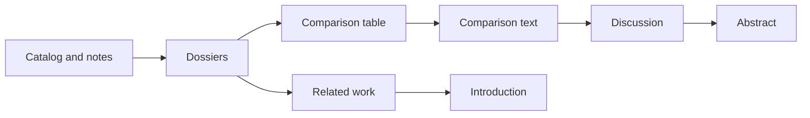

# article/

The write-up of the study as a **literature review article** in LaTeX: an
introduction, related work, and above all a **side-by-side comparison of
methods** with pointers to where each one is described. No new results.

**What ships is a template, not content.** The title, abstract, every
section and the table are placeholders (`\todo{...}`) with guidance on what
to write. Nothing in here assumes a subject, so it forks cleanly for any
topic. Whoever runs a study fills it in.

## What belongs here, and what doesn't

**Belongs here:** the article itself — prose, the comparison table, figures
(TikZ sources), and its reference list.

**Does not belong here:**

- **Literature notes and dossiers.** They stay in `../study/`
  (`notes/`, `catalog.md`, `topics/`). The article draws on them; it does
  not replace them. A claim in the article should be traceable to a note.
- **Decisions and brainstorming.** Those are `../decisions.md` and
  `../ideation/`. A review reports what the literature says, not what the
  project chose.
- **Built PDFs and LaTeX build output.** Gitignored; rebuild locally.

The split matters because the article is a *view* of the study. If it
becomes the only place a finding is recorded, the finding has no source
trail and the next edit can silently change it.

## Layout

| Path | Holds |
|---|---|
| `main.tex` | Preamble, title, abstract, and the `\input` order of the sections |
| `sections/` | One `.tex` file per section, plus `references.tex` |
| `sections/comparison_table.tex` | The table's float, caption and label. Hand-written |
| `sections/comparison_rows.tex` | The table body. **Generated** from the notes' method cards by `study/scripts/build_article_table.py`; never hand-edit |
| `figs/` | TikZ sources, one file per figure, `\input` from the sections |

## Filling it in

The step-by-step process, the rules that hold throughout (above all: **no
decisions in the review**), and the definition of done are in
[`workflow.md`](workflow.md). In short:

The article is written from the study, in this order. The question the
diagram answers: where does each part of the paper come from?



1. **Fix the scope** in `../study/ai_instructions/scope.md` first. The
   article's "Scope and method" section is that scope in prose.
2. **Table and taxonomy first.** Decide the columns (the fields in
   `../study/ai_instructions/method-card.md`) and the method families, have
   the notes carry method cards, generate the table with
   `study/scripts/build_article_table.py`, and draw `figs/taxonomy.tex`.
   The table is the core; the rest explains it.
3. **Related work and comparison text** next, one paragraph per family or
   earlier review.
4. **Introduction, discussion and abstract last**, once you know what the
   comparison shows. They are the easiest to write and the easiest to get
   wrong early.
5. **Remove the status banner** in the abstract only after every table entry
   and claim has been checked against its source.

A table row exists because a note has a method card, and its reference is
derived from the catalog entry, so a row cannot lack a source. To change a
cell, change the card in the note and rerun the script; never edit
`comparison_rows.tex`.

## Conventions

- **`\todo{...}`** marks unwritten text, in red. The validator reports how
  many remain; none should be left before sharing the draft.
- **`\openissue{...}`** sets off a question the sources do not settle.
- **Citations.** The root `CLAUDE.md` requires numbered markers in order of
  first appearance with a reference list at the end, local to each file. In
  LaTeX that is `\cite{key}` plus a plain `thebibliography` list in
  `sections/references.tex` (no bibtex run). The `cite` package numbers
  entries in order of first citation, and the numbering is local to this
  article. Each source should be in `../study/catalog.md` with a note in
  `../study/notes/`.
- **Check.** `study/scripts/validate_repo.py` fails if a `\cite` key has no
  matching `\bibitem` (it would render as `[?]`) and warns about a
  `\bibitem` that is never cited.
- **Status banner.** The abstract says the draft is AI-assisted and
  unverified. That is the honest state of any draft until checked.

## Build

```bash
pdflatex main.tex
```

Run it twice so cross-references resolve, or use `latexmk -pdf main.tex`.
