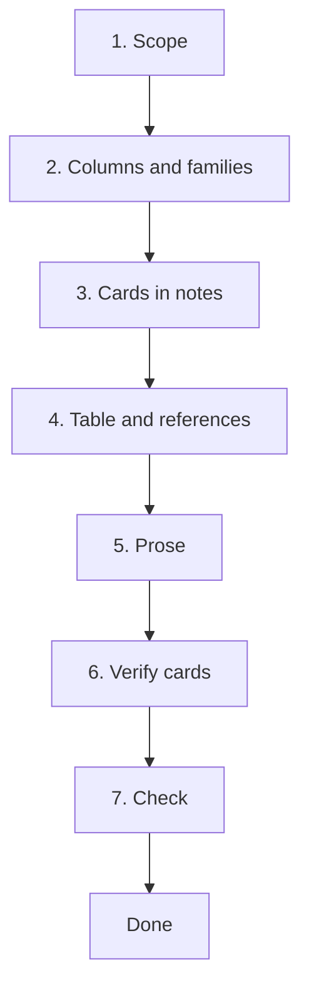

# Workflow: producing the review article

This file says how Claude and the user produce the article in `article/`.
`README.md` in this folder says what the article is and what belongs in
it. The whole sequence is available as the `/article` command
(`.claude/commands/article.md`).

## Rules that hold at every step

- **Phase 1 only, no decisions.** The review reports what the literature
  says. It never says what the project chose, recommends a method for the
  product, or rules one out for the project's sake. Those belong to the
  concept phase (`../decisions.md`, `../ideation/`). Refining the *scope*
  of the study and of the article is allowed; deciding the product is not.
  `validate_repo.py` warns on decision language ("we chose", "our design",
  "should be used", and similar) anywhere in `article/*.tex`. It is
  advisory, since a quoted source can say "we chose", but a hit means the
  article is drifting out of phase 1 and deserves a look.
- **The article is a view of `study/`.** A finding is recorded in
  `../study/` (note, dossier) first and only then used here. If it exists
  only in the article, it has no source trail.
- **Every table row and every claim cites a source** that is in
  `../study/catalog.md`.
- **The status banner stays** until the verification pass (step 6) has
  passed for every card. The validator warns if the banner is removed
  while cards are unverified. Removing it is the user's act, never
  Claude's.

## Steps



1. **Scope.** `../study/ai_instructions/scope.md` is the source. The
   article's *Scope and method* section is that scope in prose. If writing
   the article shows the scope is wrong, change `scope.md` first, then the
   article.
2. **Columns and method families.** Decided by the user, from the first
   dozen or so documents and the dossiers in `../study/topics/`. Claude
   proposes; the user chooses.
   - **Columns** are the field list in
     `../study/ai_instructions/method-card.md`. Settle them before
     extracting many cards: changing a column later means revisiting every
     card.
   - **Families** are listed in `../study/topics/families.md`, which ships
     empty. They group the table's rows, become the nodes of
     `figs/taxonomy.tex` and the subsections of `sections/comparison.tex`,
     and are written into cards by the coordinator after ratifying a
     worker's proposal.
3. **Cards in the notes.** Each note of a document that has a method of its
   own carries a `## Method Cards` section, written by the `note-extractor`
   while it reads the document (`/process-batch`). A survey of other
   people's work, a standard or a dataset gets none.
4. **Table and references, generated.**

   ```bash
   python study/scripts/build_article_table.py
   ```

   rewrites two derived files, neither of which is ever hand-edited:
   `sections/comparison_rows.tex` (the table body, one row per card) and
   `sections/references.tex` (the whole bibliography, in order of first
   citation in the source, so numbers follow the repo's convention). The
   cite key is the first author's surname plus year, derived from the
   catalog; fix a wrong surname in `../study/catalog.md`, not in the
   article. A source that is not in the catalog (a provided document, a
   rulebook) is a hand-written `\bibitem` in `sections/references_extra.tex`.
   `validate_repo.py` rebuilds both files on every run and warns if they
   were stale.
5. **Prose.** Related work (earlier reviews only), the comparison text per
   family, then discussion, introduction and abstract last, once the
   comparison shows what it shows. Drafted from the dossiers, with
   citations. `\cite{key}` must resolve; the validator fails on a key with
   no bibliography entry.
6. **Verify cards.** The cards were written by one reading of the
   document; this step is a second, independent one. For each note with
   unverified or stale cards, launch one **`row-verifier`** agent
   (`.claude/agents/row-verifier.md`: Haiku, low effort, read-only, one
   call per note). It is given the cards and reads only the note's
   `## Content`, never the article and never the card's own note sections,
   so it is not anchored on the original reading. It reports, per field,
   supported / unsupported / unclear with a short quote and page. The
   coordinating session reads the report and records each verdict:

   ```bash
   python study/scripts/verification.py todo      # cards needing a check
   python study/scripts/verification.py record "notes/x.md#Method" pass "comment"
   python study/scripts/verification.py status    # all cards
   ```

   Verdicts are stored in `../study/verification.json` against a hash of
   the card, so **editing a card makes its verdict stale** and it must be
   checked again. A `fail` or `unclear` is shown to the user with the
   quote, and the card or the note is fixed with their say-so.
7. **Check.** `python study/scripts/validate_repo.py`: citations resolve,
   cards are well formed, derived files are current, verified count,
   decision-language warnings, `\todo` count. Build with `pdflatex main.tex`
   twice.

**Done** means: no `\todo`, all citations resolve, every card verified,
scope final, status banner removed, no decision-language warnings left
unexplained, and the user has read the whole PDF.

## Not part of this workflow

- **Defining the project** (scope, introduction, problem description as a
  standalone document that comes *before* this article) is a separate,
  earlier step; see `../roadmap-notes.md` on the `development` branch.
- **Gates** (forced stops to read and understand) are the
  `dev-gate-events` feature; see `../roadmap-notes.md`.
