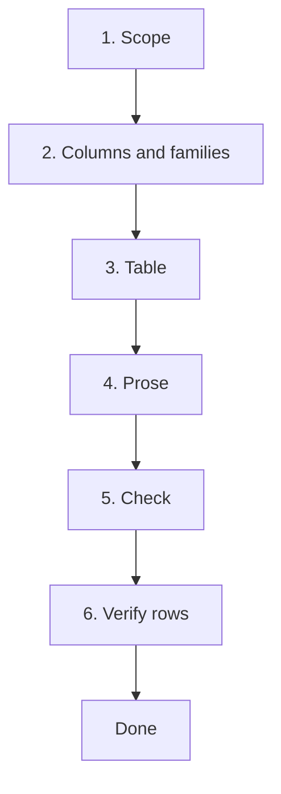

# Workflow: producing the review article

**Status: first definition, 2026-10-29. Steps marked *pending* depend on
open decisions and are not built.** This file says how Claude and the user
produce the article in `article/`. `README.md` in this folder says what the
article is and what belongs in it.

## Rules that hold at every step

- **Phase 1 only, no decisions.** The review reports what the literature
  says. It never says what the project chose, recommends a method for the
  product, or rules one out for the project's sake. Those belong to the
  concept phase (`../decisions.md`, `../ideation/`). Refining the *scope*
  of the study and of the article is allowed; deciding the product is not.
- **The article is a view of `study/`.** A finding is recorded in
  `../study/` (note, dossier) first and only then used here. If it exists
  only in the article, it has no source trail.
- **Every table row and every claim cites a source** that is in
  `../study/catalog.md`.
- **The status banner stays** until a verification pass (step 6) has
  checked the entries against their sources.

## Steps



1. **Scope.** `../study/ai_instructions/scope.md` is the source. The
   article's *Scope and method* section is that scope in prose. If writing
   the article shows the scope is wrong, change `scope.md` first, then the
   article.
2. **Columns and method families.** Decided by the user, from the first
   dozen or so documents and the dossiers in `../study/topics/`. Claude
   proposes; the user chooses. The columns are the field list in
   `../study/ai_instructions/method-card.md`. **Settle them before
   extracting many cards**: changing a column later means revisiting every
   card. The families become `figs/taxonomy.tex` and the subsections of
   the comparison.
3. **Table, from method cards.** Each note of a document that has a method
   of its own carries a `## Method Cards` section, written by the
   `note-extractor` while it reads the document. Then:

   ```bash
   python study/scripts/build_article_table.py            # rewrite comparison_rows.tex
   python study/scripts/build_article_table.py --bibitems # ibitem entries still missing
   ```

   `sections/comparison_rows.tex` is generated and never hand-edited;
   `sections/comparison_table.tex` holds the float and caption. Paste the
   printed `ibitem` entries into `sections/references.tex` (the cite key
   is the first author's surname plus year, derived from the catalog, so
   fix a wrong surname in `../study/catalog.md`, not in the article). A
   row you want that has no card means the note is missing one: fix the
   note.
4. **Prose.** Related work (earlier reviews only), the comparison text per
   family, then discussion, introduction and abstract last, once the
   comparison shows what it shows. Drafted from the dossiers, with
   citations.
5. **Check.** `python study/scripts/validate_repo.py`: every `\cite` has a
   `\bibitem`, method cards are well formed, the table is current, no
   unbalanced fences, `\todo` count. Build with `pdflatex main.tex` twice.
6. **Verify rows.** A fresh agent, given only a row and the cited
   document, checks the row against the source and reports mismatches. It
   does not see the article's conclusions. *Pending:* a worker definition
   under `../.claude/agents/`.

**Done** means: no `\todo`, all citations resolve, every row verified,
scope final, status banner removed, and the user has read the whole PDF.

## Not part of this workflow

- **Defining the project** (scope, introduction, problem description as a
  standalone document that comes *before* this article) is a separate,
  earlier step; see `../roadmap-notes.md`.
- **Gates** (forced stops to read and understand) are the
  `dev-gate-events` feature; see `../roadmap-notes.md`.
