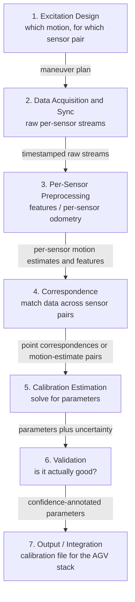
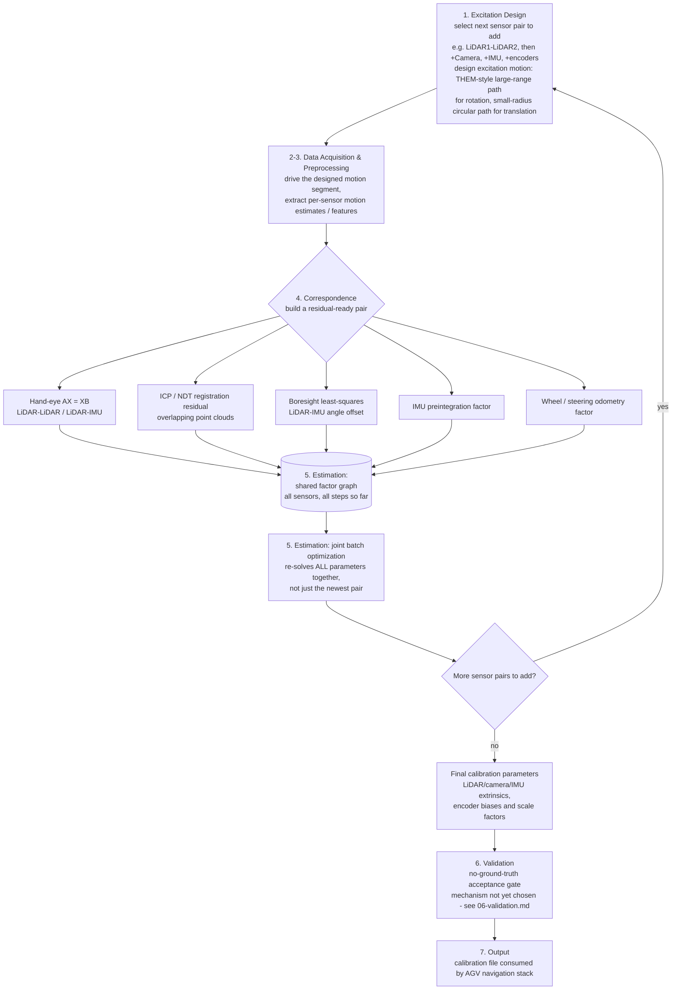

> **Status: unverified ideation.** This is an exploration map, not a
> decision. The goal is to lay out every viable branch at every point
> where this pipeline could be built one of several ways — not to pick
> one. See `../decisions.md` for what's actually been decided and why,
> and the per-stage deep-dive files (`01-excitation-design.md` through
> `07-output-integration.md`, plus `vehicle-and-sensor-layout.md`) for
> what's already been explored in depth.

# Calibration pipeline: full architecture tree

Sensor readings in, calibrated sensors out — the whole system, mapped
broadly first, branching at every point where more than one approach is
viable, then dug into deeper one branch at a time: start with the big
functional blocks, then branch each one out.

## Why the pipeline is a linear, offline sequence rather than a loop

This project is a **mostly linear, offline process**: drive a
deliberately designed route, collect data, then compute calibration
parameters afterward — not repeated indefinitely (per earlier scoping:
this project is only concerned with the *first* factory calibration,
not live/online recalibration). That's why the stages below run once,
in sequence, rather than looping — big functional blocks first, branch
each one, define clean interfaces so people can split up the work.

## Top-level pipeline stages

| # | Stage |
|---|---|
| 1 | Excitation Design |
| 2 | Data Acquisition & Sync |
| 3 | Per-Sensor Preprocessing |
| 4 | Correspondence / Association |
| 5 | Calibration Estimation |
| 6 | Validation |
| 7 | Output / Integration |

## Interfaces between stages

Defining these early is what lets different team members own different
stages independently — whoever builds stage 3 doesn't need to know how
stage 5's optimizer works, only what shape of data it needs to hand
off. Formats are placeholders (TBD), not yet decided.

| From → To | What crosses the boundary |
|---|---|
| Excitation Design → Data Acquisition | An ordered maneuver plan: which driving pattern, targeting which sensor pair, in what sequence. |
| Data Acquisition → Preprocessing | Per-sensor raw streams (point clouds, images, IMU samples, encoder ticks), each timestamped on a common or reconcilable clock, plus sync metadata (hardware-synced or not). |
| Preprocessing → Correspondence | Per-sensor motion estimates and/or extracted features, time-indexed to a shared reference. |
| Correspondence → Estimation | Residual-ready pairs: either point correspondences (overlapping FOV) or paired motion-estimate segments (non-overlapping / non-LiDAR). |
| Estimation → Validation | The calibration parameter estimate plus its uncertainty/covariance, ideally per-DOF (see the observability note in `05-calibration-estimation.md` — roll/pitch are expected to be poorly observed regardless of graph design). |
| Validation → Output | Parameters annotated with a pass/fail or confidence judgment. |
| Output → AGV stack | A calibration file/config the navigation stack actually consumes. |

## Full branch tree

Legend: ✅ = already explored (linked below) · 🔲 = identified but not
yet explored · a branch with no mark is a first-cut idea from this
mapping pass, not yet checked against literature either way.

```mermaid
flowchart TD
    subgraph STAGE1["1. Excitation Design"]
        E0[Design motion plan] --> E1["A: Per-pair purpose-built motion<br/>THEM-style two-phase: rotation pass + translation pass<br/>✅ 01-excitation-design.md"]
        E0 --> E2["B: One generic rich drive<br/>not tailored per pair, simpler to execute<br/>🔲 not yet explored / not compared against A"]
        E0 --> E3["Execution: scripted/autonomous vs. manual driving<br/>🔲 not yet explored"]
    end

    subgraph STAGE2["2. Data Acquisition and Sync"]
        A0[Capture and timestamp raw data] --> A1["A: Hardware time sync<br/>common trigger / PTP clock<br/>🔲 depends on Toyota hardware - open question"]
        A0 --> A2["B: Software-estimated time offset<br/>per-pair offset becomes its own calibrated state<br/>✅ 02-data-acquisition-sync.md"]
    end

    subgraph STAGE3["3. Per-Sensor Preprocessing"]
        P0[Per-sensor feature / motion extraction]
        P0 --> PL["LiDAR odometry<br/>KISS-ICP / LOAM family / CT-ICP<br/>✅ 03-per-sensor-preprocessing.md"]
        P0 --> PC["Camera: feature detection / matching<br/>🔲 not yet explored"]
        P0 --> PI["IMU preintegration<br/>✅ 05-calibration-estimation.md"]
        P0 --> PE["Encoder odometry<br/>tricycle / rear-steer-drive kinematic model<br/>✅ 03-per-sensor-preprocessing.md"]
    end

    subgraph STAGE4["4. Correspondence / Association"]
        C0[Build residual-ready pairs]
        C0 --> C1["A: Direct point cloud registration<br/>ICP / GICP / NDT / TEASER++, needs FOV overlap<br/>✅ 04-correspondence-association.md"]
        C0 --> C2["B: Motion comparison (hand-eye)<br/>no FOV overlap needed<br/>✅ 04-correspondence-association.md"]
        C0 --> C3["C: Learned / cross-modal feature matching<br/>🔲 one catalog paper flagged, not synthesized into this map yet"]
    end

    subgraph STAGE5["5. Calibration Estimation"]
        S0[Solve for calibration parameters]
        S0 --> S1["A: EKF / UKF<br/>real-time capable, single-pass linearization<br/>✅ evaluated - not favored, no real-time need in this project"]
        S0 --> S2["B: Particle filter<br/>🔲 no literature support found either way"]
        S0 --> S3["C: Batch nonlinear least squares<br/>most accurate, solved once over all data<br/>✅ Rehder et al. - NOTE: C and D are the same underlying math,<br/>see 05-calibration-estimation.md"]
        S0 --> S4["D: Incremental factor graph<br/>jointly re-optimized as each pair is added<br/>✅ deep-dive: 05-calibration-estimation.md"]
        S0 --> S5["E: Strictly sequential pairwise (freeze-then-chain)<br/>known compounding-error failure mode<br/>✅ evaluated - weakness identified, not excluded"]
    end

    subgraph STAGE6["6. Validation"]
        V0[Assess calibration quality]
        V0 --> V1["A: No-ground-truth consistency check<br/>REQUIRED per unit - no fallback exists<br/>✅ 7 candidate mechanisms A1-A7, deep-dive: 06-validation.md"]
        V0 --> V2["B: Semantic-feature cross-check<br/>usable per unit<br/>✅ Das et al. - a special case of A3"]
        V0 --> V3["C: Compare against CAD / design priors<br/>method validation only, never per unit"]
        V0 --> V4["D: Compare against Toyota's reference calibration<br/>method validation only, never per unit"]
        V0 --> V5["E: Independent validation drive<br/>usable per unit<br/>✅ partially explored - scored with A1-A4"]
        V0 --> V6["F: Learned miscalibration classifier<br/>usable per unit, training needs a reference<br/>✅ Tahiraj et al. x2 - an actual accept/reject gate"]
    end

    subgraph STAGE7["7. Output / Integration"]
        O0[Produce final artifact]
        O0 --> O1["A: Static config file<br/>extrinsics + encoder params"]
        O0 --> O2["B: Per-DOF confidence alongside point estimates<br/>🔲 not yet explored"]
        O0 --> O3["C: Versioning / audit trail<br/>which excitation drives contributed, when<br/>🔲 not yet explored"]
    end

    STAGE1 --> STAGE2 --> STAGE3 --> STAGE4 --> STAGE5 --> STAGE6 --> STAGE7
```

Stage 6's "usable per unit" vs. "method validation only" marks are the
one place a branch's viability depends on *when* it runs rather than on
how well it works. A reference measurement can be built once, during
development, to prove the calibration method itself is sound; no
reference will ever exist for an individual truck coming off the line,
which is what branches C and D are excluded from. `06-validation.md`
splits that into three separate validation questions and works through
each branch against them.

## A concrete instance: the incremental factor-graph loop

The branch tree above shows every stage's options side by side. This
diagram is different: it's one specific idea — Stage 5's branch D
(incremental factor graph, deep-dive in `05-calibration-estimation.md`)
— traced through *all seven stages* as a single loop, one sensor pair
at a time. It's a diagram of that idea, not a verified or decided
architecture — see `05-calibration-estimation.md`'s open questions.

## Planning order vs. this map's structure

This document maps *structure* — which branch a piece of work belongs
to and what data crosses each stage boundary. *Planning* order (which
decisions block which pieces of work, and what can run in parallel) is
a related but different question, since the two don't actually match —
notably, Stage 1 (Excitation) depends on Stage 5 (Estimation)'s
approach, not the reverse, and Stage 6 (Validation) has to be designed
alongside Stage 5 rather than after it. See `../timeline.md`'s
"Milstolpar" section for that dependency diagram and the phase/track
breakdown built on it.

## How this relates to `../study/topics/*.md`

The topic dossiers (`lidar-camera-calibration.md`,
`multi-lidar-extrinsic-calibration.md`,
`lidar-imu-boresight-calibration.md`, `odometry-encoder-calibration.md`,
`miscalibration-fault-detection.md`, `spatiotemporal-calibration.md`)
are organized by **which sensors** are being calibrated. This document
is organized by **which pipeline stage** a piece of work belongs to. The
two are orthogonal cuts through the same problem — a real solution picks
one branch per stage, per sensor pair, and the topic dossiers are the
place to check what the literature says about a specific sensor
pairing, while this tree is the place to check where that pairing's
work fits into the overall data flow and what else has to be true
around it (interfaces, sequencing, what stage feeds it).

## Status of exploration

| Stage | Branches identified | Deep-dive exists? | Biggest gap |
|---|---|---|---|
| 1. Excitation Design | 3 | Partial — per-pair motion design worked out | Generic-drive alternative (B) never compared against purpose-built (A); execution method untouched |
| 2. Data Acquisition & Sync | 2 | Partial — time-offset-as-state worked out | Whether hardware sync even exists is an open Toyota question, not a literature question |
| 3. Per-Sensor Preprocessing | 4 (per sensor type) | Partial — LiDAR, IMU, encoder done; camera not started | Camera feature pipeline is entirely unexplored |
| 4. Correspondence / Association | 3 | Partial — registration + hand-eye done | Learned/cross-modal matching barely touched |
| 5. Calibration Estimation | 5 | Deep — has its own document | Tooling/library choice, incremental-solver engineering detail |
| 6. Validation | 6 | Deep — has its own document (`06-validation.md`): seven candidate no-ground-truth mechanisms, three distinct validation questions, shared failure modes | No paper applies covariance or hypothesis testing as a final accept/reject gate on a *completed* multi-sensor calibration — closest examples do it mid-adjustment or pre-calibration. The acceptance *tolerance* is a Toyota question, not a literature one. **No fallback exists per unit** (branches C/D are method-validation-only), so this stays the highest-stakes open gap in the map |
| 7. Output / Integration | 3 | Not started | Essentially a blank slate |

## Suggested order for digging deeper

Not a decision, just an observation: Estimation (5) is by far the
furthest along, since it's what the original conversation happened to
start with. Camera preprocessing (3) is a clean, self-contained next
chunk — nothing else in the collection has been checked for it yet.
Validation (6) is the most consequential gap, and not just because
it's echoed by every topic dossier independently — the shipped product
has no fallback if the no-ground-truth approach (branch A) doesn't pan
out, since the project's whole point is removing the external
measurement/reference dependency that branches C/D would otherwise
provide (see `06-validation.md`). It now has enough mechanisms
identified to prototype against; what it still lacks is an acceptance
*threshold*, which needs a Toyota-side accuracy requirement more than
it needs more papers.
Output (7) is the least literature-dependent — mostly an engineering/
team-process design exercise, quick to flesh out whenever someone has a
gap between other work. Which to tackle first, and in what order, is a
team call, not something to lock in here.

## See also

- `../timeline.md` — the "Milstolpar" section has the planning-order
  dependency diagram and the phase/parallel-track breakdown built from
  this map's structure.
- `01-excitation-design.md` — deep dive on Stage 1.
- `02-data-acquisition-sync.md` — deep dive on Stage 2.
- `03-per-sensor-preprocessing.md` — deep dive on Stage 3.
- `04-correspondence-association.md` — deep dive on Stage 4.
- `05-calibration-estimation.md` — deep dive on Stage 5, plus the state
  space it consumes.
- `06-validation.md` — deep dive on Stage 6.
- `07-output-integration.md` — deep dive on Stage 7.
- `vehicle-and-sensor-layout.md` — the vehicle/sensor/drivetrain facts
  shared across Stages 1, 3, and 5.
- `tooling-and-language-choice.md` — Python/C++/ROS2/MATLAB tradeoffs
  for implementing Stages 3-5.
- `estimation-methods-landscape.md` — broad, shallow survey of
  estimation-method families beyond Stage 5's branches A-E.
- `estimation-method-comparison.md` — structured, deliberately-unbiased
  comparison across every candidate from Stage 5 and the landscape
  survey, scored against this project's actual constraints.
- `self-supervised-calibration-deep-dive.md` — deep dive on the
  landscape survey's most relevant find for the no-ground-truth
  constraint.
