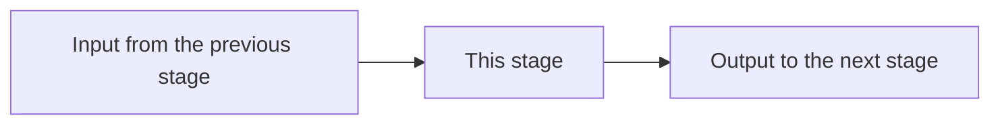

> **Status: unverified ideation.** This is brainstorming, not literature
> or a decision. Nothing here should be treated as validated fact or
> cited as a literature basis for a decision — see `../decisions.md` for
> what's actually been decided and why.

<!--
  TEMPLATE: a deep-dive on ONE stage of a topic. Copy to
  ../<N>-<stage>.md (numbered in pipeline order), delete this comment, and
  fill in. A deep-dive is neutral: it lays out the candidates and the
  evidence for each and does NOT pick one. Picking is a recommendation
  (recommendation.md), and only the user's decision makes it a decision.
-->

# <N>. <Stage>

## The question this stage answers

<One sentence, phrased as a question.>

## What crosses the boundaries

The question this diagram answers: <what goes into this stage and what
comes out of it, and from and to which stages?>

<The prose around the diagram says the same thing in words.>

## Method families

The question this diagram answers: <which families of approach exist, and what
does each one need as input?>

<One paragraph per family: the idea in plain words, what it needs, where it
works and where it fails.>

## Evidence by context

A table with one row per family and one column per *kind of evidence that
matters for this study*. Fill the columns in before filling the cells: which
kinds of evidence count is a judgement about the study, and it is what makes
the difference between "closest to our case" and "best validated" visible, since
they are often different papers.

How to choose the columns: ask what a sceptical reader would want shown
before trusting a method. Typical answers are a column for theory, a column for
the case closest to ours, a column for other cases, a column for simulation and
a column for use in service, but rename, add and drop freely.

Each cell holds citations as numbered markers, or is left empty. An empty cell
is information, not a defect: it is a gap, and gaps feed
`../study/topics/gaps.md`.

| Family | <kind of evidence 1> | <kind of evidence 2> | <kind of evidence 3> |
|---|---|---|---|
| Family A | | | |
| Family B | | | |

## Failure modes

<For each family: how it fails, and what the sources say about when.
Authors' own admitted limitations count.>

## Open questions

<What the evidence does not settle. Each item is a candidate entry for
`../study/topics/gaps.md`.>

## References

<Numbered `[1]`, `[2]`, … in order of first appearance, local to this file:
author(s), year, title, and a relative path into `../study/notes/`. See the
root `CLAUDE.md`.>
