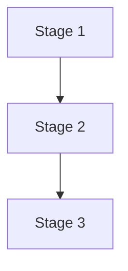

> **Status: unverified ideation.** This is brainstorming, not literature
> or a decision. Nothing here should be treated as validated fact or
> cited as a literature basis for a decision — see `../decisions.md` for
> what's actually been decided and why.

<!--
  TEMPLATE: the map file of an ideation topic. Copy to ../<topic>-map.md (or
  to <topic>/map.md inside a topic subfolder), delete this comment, and fill
  in. The map is the entry point: it names the stages, how they connect, and
  where each deep-dive lives. It does not argue for anything; arguing happens
  in a recommendation (see recommendation.md).
-->

# <Topic>: map

<One or two sentences: what this topic is and what the map is for.>

## What an edge means (decide this before drawing)

A graph is unreadable if its edges mean different things in different places,
so state the meaning of each edge style here first, then keep to it:

- **No edge between two nodes:** <e.g. they are alternative approaches>
- **A single arrow:** <e.g. one-directional dependency or data flow>
- **A double-headed arrow:** <e.g. genuine mutual coupling>

## Pipeline

The question this diagram answers: <which stages exist, in what order, and
what is handed from one to the next?>

Keep node labels to a few words; the explanation belongs in the prose around
the diagram, which must make sense without it.

## Stages

| # | Stage | The question it answers | Deep-dive | State |
|---|---|---|---|---|
| 1 | | | `1-<stage>.md` (not written yet) | not started |

State is one of `not started`, `draft`, `explored`. A deep-dive that does not
exist yet is named here anyway, so a gap in the map is visible as a gap.

## Shared files

<Facts or derivations used by more than one stage live in their own file and
are listed here, never copied into several stages: a duplicated fact is a
fact that will diverge.>

## Open threads

<Questions the map raises that nothing has answered yet. Each one is flagged
as needing research, never presented as settled. A thread that matters belongs
in `../study/topics/gaps.md` too, so it can drive acquisition.>
