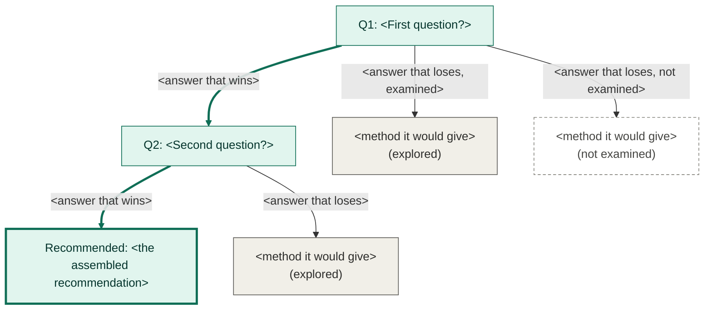

> **Status: unverified ideation.** This is brainstorming, not literature
> or a decision. Nothing here should be treated as validated fact or
> cited as a literature basis for a decision — see `../decisions.md` for
> what's actually been decided and why.

<!--
  TEMPLATE: a recommendation. Copy to ../<topic>-recommendation.md, delete this
  comment, and fill in. A deep-dive lays options out neutrally; a recommendation
  weighs them against stated criteria and reaches a conclusion. It is the only
  kind of ideation file that argues for something, and it stays unverified until
  the user decides. When they do, record the decision in ../decisions.md, link
  this file from the entry, and add one line under the banner above:
  `Decided in: <decisions.md entry title>`. The file stays.
-->

# <Topic>: recommendation

## The question

<The decision, phrased as a question, and what it covers. One short paragraph.>

## Candidates

<The options being weighed, each linked to the deep-dive that describes it (a
neutral file, `<N>-<stage>.md`). A candidate with no deep-dive behind it is
flagged as unexplored here, in the open.>

## Criteria

<What the choice is judged on, stated before the verdict and in order of
weight, each with one line on why it matters. A recommendation whose criteria
appear only after the conclusion is a conclusion looking for a justification.>

| # | Criterion | Why it matters |
|---|---|---|
| 1 | | |

## Decision tree

The question this tree answers: <what path of decisions leads from the open
question to a recommended method, and what was rejected on the way?>

Read it from the top. Every box is a question; every arrow out of it is one
possible answer, and all of them are drawn. Only the chosen answer continues
downward to the next question. Every other answer stops in a box naming the
method it would have given, solid if it was examined and dashed if it was only
listed. The thick path is the recommendation.

The table is the source; the diagram under it is generated from it by
`study/scripts/build_decision_trees.py` and is never edited by hand. Write a
`motivation` for every chosen and every examined answer: each edge is a
placeholder for the reason the team gives when it decides, and the validator
counts the ones still empty. A `|` cannot appear inside a cell.

<!-- decision-tree -->
| Q | question | answer | status | then | method | source | motivation |
|---|---|---|---|---|---|---|---|
| Q1 | <First question?> | <answer that wins> | chosen | Q2 | | | |
| Q1 | | <answer that loses, examined> | explored | | <method it would give> | | |
| Q1 | | <answer that loses, not examined> | identified | | <method it would give> | | |
| Q2 | <Second question?> | <answer that wins> | chosen | END | <the assembled recommendation> | | |
| Q2 | | <answer that loses> | explored | | <method it would give> | | |
<!-- /decision-tree -->

<!-- decision-tree-diagram: generated by study/scripts/build_decision_trees.py from the table above; do not edit -->

<!-- /decision-tree-diagram -->

## Conclusion

<The recommended method, assembled from the chosen answers, in prose. State it
once, plainly, and say how sure the evidence lets you be.>

## What this rests on

<The assumptions the conclusion depends on, stated plainly: a figure held
constant, a source taken at its word, a condition assumed to hold. The ones
nobody wrote down are the ones that cause trouble. Each is a place to challenge
the recommendation.>

## Alternatives rejected, and why not

<The table above already lists them with a motivation each. Add here anything
the table cannot hold: an alternative that was never a candidate but a reader
will ask about, and why.>

## Revisit if

<What would make this recommendation wrong, so that a future reader knows when
to reopen it.>

## Open items

<What is still unexplored (the dashed boxes), and what would settle it. Items
that matter belong in `../study/topics/gaps.md` too.>

## References

<Numbered `[1]`, `[2]`, … in order of first appearance, local to this file:
author(s), year, title, and a relative path into `../study/notes/`. See the
root `CLAUDE.md`.>
