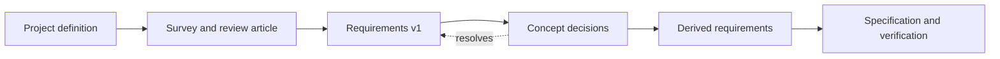

# requirements/

> **Optional module, leaning towards engineering.** For projects where
> something is being *built* to a specification. A study that only reviews
> literature does not need it: delete this folder and nothing else breaks. The
> validator looks at it only if it exists.

**This folder is a description on purpose.** What a good requirements process
looks like depends on the kind of project (software, control, estimation,
mechanical, …), and it cannot be designed well in the abstract. So for now this
module says *where requirements sit in the pipeline, when they are written, and
what they feed*, and collects the background gathered so far
(`background.md`). The detailed templates and procedures are to be designed one
project type at a time, from real use: friction with this module shows up first
in the usage log (`../.claude/usage-log.md`).

## What belongs here, and what doesn't

**Belongs here:** the project's requirements, and the register of what is still
`TBD`.

**Does not belong here:**

- **Top-level facts and goals** (purpose, stakeholders, hard constraints that
  are facts, non-goals, open unknowns). Those are the project definition and
  `../study/ai_instructions/scope.md`.
- **Literature.** That is `../study/`.
- **A choice between ways of building it.** That is `../decisions.md` and
  `../ideation/`. A requirement says what must hold; a decision says how it will
  be met.
- **Material handed down from outside**, such as another team's draft
  requirements. That stays in `../intake/received/`, untouched. Someone else's
  draft is an input and a placeholder, never a source of truth.
- **The design.** A requirement that names the solution is a decision in
  disguise.

## When requirements are written

The question this diagram answers: at which point in the pipeline is each kind
of requirement written, and what does it need from the step before?

Requirements are written in three stages, and the later stages are not allowed to
start early:

1. **Top level, at the start.** Facts and directions: what the thing is for, the
   rules and physics it must live with, the budget and time, and what it is
   explicitly not for. These go in the project definition, not in this folder,
   and contain no number that is a *choice*.
2. **Version 1, after the survey.** Once the review article is done, the study
   knows what is typical and what is achievable, so values stop being guesses.
   This is the first requirements list. Many entries will still be `TBD`.
3. **Derived, after the concept is decided.** Lower-level requirements follow from
   the concept that was chosen, so they are written once the decision they depend
   on has been taken, not before.

**Why not earlier.** A precise low-level number written before the concept is
understood gets treated as a fact, and the design bends to meet it. It may be
infeasible, or met cheaply by a design that a better concept would not need, or
simply someone's placeholder that nobody questioned. Established practice says
the same thing: *feasibility* is a property a requirement must have; unknown
values are recorded as `TBD`/`TBR` with a plan to close them, not guessed; and a
requirements list is kept alive through the project because knowledge of the
requirements grows with knowledge of the problem (see `background.md`).

**`TBD` is a normal state, not a defect.** A requirement may have no value yet.
Write it as `TBD`, with an owner, the milestone by which it must be resolved, and
what it is waiting for. A `TBD` that waits on evidence belongs in
`../study/topics/gaps.md` or `../study/leads.md`; one that waits on a choice is
resolved by a decision. A list with a few honest `TBD`s is healthier than one
with every number filled in.

**Demand or wish.** Say which. A demand must be met; a wish is wanted if it costs
little. They are different information to a designer, and blurring them is how an
inflated wish becomes a hard constraint.

## What requirements consume and feed

The question this table answers: where do requirements come from, and where do
they go?

| From | Into | What flows |
|---|---|---|
| Project definition | Requirements v1 | The demands that are facts: rules, physics, interfaces, budget, time |
| Review article and catalog | Requirements v1 | What is typical and achievable, as evidence for values and for feasibility |
| Requirements v1 | Recommendations and decision trees (`../ideation/`) | The criteria: demands filter the candidates, wishes weight them |
| Decisions (`../decisions.md`) | Requirements | `TBD`s that a decision resolves; the derived requirements it makes writable |
| A `TBD` waiting on evidence | `../study/topics/gaps.md`, `../study/leads.md` | A gap or a lead to pursue |
| A `TBD`'s resolve-by milestone | `../timeline.md` | The date it constrains |
| Requirements | Specification and test plan (later documents) | What must be shown to hold |
| Requirement ids | Implementation repo, at the split | What each test traces back to |

## Conventions, kept light

These are the minimum; detailed forms are for the per-type design later.

- **What must hold, not how.** No solution in the statement.
- **One requirement, one statement, one place,** with a stable id.
- **A value, or `TBD`** with owner, resolve-by milestone, and what it waits on.
- **A basis:** where the value comes from (a rule or regulation, physics, a
  measurement, someone's draft, an assumption), cited by the root `CLAUDE.md`
  convention. A requirement whose only basis is a draft or an assumption is weak,
  and says so.
- **Nothing counts as accepted until the user accepts it.** Claude may propose;
  the user decides, as for `../decisions.md`.

## The early-writing warning

`study/scripts/validate_repo.py` **warns, never fails,** when this folder holds
anything beyond `README.md` and `background.md` and at least one of these is true:

- `scope.md` is still a placeholder;
- no document has been processed into the catalog yet;
- the review article exists and still carries its "not verified" status banner.

It also counts the `TBD`/`TBR` markers in the folder, as information.

The warning is a prompt to ask, not a ruling. A project may legitimately start
from a fixed requirement, such as a customer specification; in that case keep the
original in `../intake/received/` and carry its demands over knowingly. On
Claude's side, the rule is in the root `CLAUDE.md`: say what this README says,
offer top-level facts and `TBD` entries instead, and let the user decide.

## How this module should evolve

Design it in detail per project type, when there is real use to design from. The
open questions are listed at the end of `background.md`. Never delete this
`README.md`: it is what makes the folder self-documenting.
