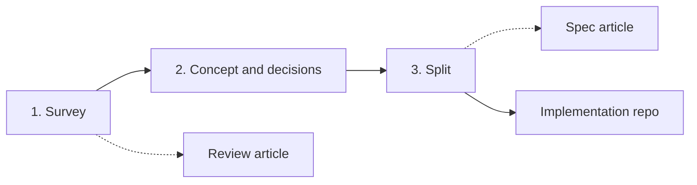

# Roadmap notes: how a study moves through phases

**Status: ideas, not designed, not built.** Written 2026-10-29 from a
discussion. Nothing here is a convention yet. It is parked so the larger
direction is not lost while `dev-article` stays focused on the review
article. When a part is built, it moves to a `dev-<feature>` branch and
into the real docs.

## The idea: a study has phases, and the repo should know which one it is in

The template today is built for the first phase only. The author's actual
use runs three.

| Phase | Goal | Output | Decisions allowed? |
|---|---|---|---|
| **1. Survey** | Understand every method that exists, find reviews and papers. May refine and update the *scope* of the papers and of the article. | Catalog, notes, dossiers, the **review article** | **No.** Nothing about the product is decided. |
| **2. Concept and decisions** | Discuss the actual thing being built: limits, requirements, priorities. Make assumptions, rule solutions out, decide. Done in the same repo because the knowledge (and the AI's context) is already there. | `decisions.md`, `ideation/`, `theory/` explainers | Yes, with the literature-basis / project-context split. |
| **3. Split** | Keep theory and concept here. Create a **separate implementation repo** (code, models) that looks clean to outsiders and carries none of the pre-study mess. | The implementation repo, plus a **spec article** that is the interface between the two repos | n/a |

The first phase is one of the first big milestones of a repo.

## Things this implies (all open)

- **A phase marker.** Somewhere the repo states which phase it is in, so
  Claude does not make decisions in phase 1 and does not treat phase-2
  material as literature. Candidate home: `timeline.md` plus a line in the
  root `CLAUDE.md`.
- **The review article stays decision-free.** Phase-2 content must not leak
  into it. The article is the artefact of phase 1 and is finished (or
  frozen) before phase 2 reasoning is written up.
- **The spec article as the repo-to-repo interface.** A second article,
  written at the end of phase 2, that describes the implementation well
  enough to build from. Inspired by the hand-written `algorithm/` folder in
  LiUFS-TorqueVectoringStudy (status banner per file, one document per goal
  and version, text only, the *why* linked to `ideation/`). Needs its own
  folder, template and status rules. Not designed yet.
- **A split procedure.** What moves to the new repo, what stays, how the
  implementation repo links back (by tag or commit of this repo, so a spec
  version is citable), and how it is kept clean. Possibly a `/split`
  command or a checklist.
- **Gates between phases.** Phase 1 to 2 is a natural place for a forced
  stop-and-read, which connects to `dev-gate-events` (printable report,
  debrief). Kept separate for now, but the two features should be designed
  so they can meet.

## Where each piece lives for now

- Phase 1 workflow and the review article: `article/` on `dev-article`
  (in progress).
- Gate events: `dev-gate-events`.
- Everything above beyond phase 1: this file only.
