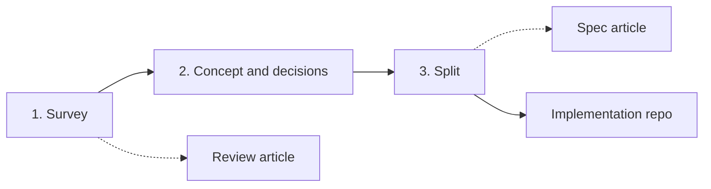

# Roadmap notes: how a study moves through phases

**Status: ideas, not designed, not built.** Written 2026-10-29 from a
discussion. Nothing here is a convention yet. It is parked so the larger
direction is not lost while the review article was built (`article-review/`,
now merged). When a part is built, it moves to a `dev-<feature>` branch and
into the real docs.

## The idea: a study has phases, and the repo should know which one it is in

The template today is built for the first phase only. The author's actual
use runs three.

| Phase | Goal | Output | Decisions allowed? |
|---|---|---|---|
| **1. Survey** | Understand every method that exists, find reviews and papers. May refine and update the *scope* of the papers and of the article. | Catalog, notes, dossiers, the **review article** | **No.** Nothing about the product is decided. |
| **2. Concept and decisions** | Discuss the actual thing being built: limits, requirements, priorities. Make assumptions, rule solutions out, decide. Done in the same repo because the knowledge (and the AI's context) is already there. | `decisions.md`, `ideation/`, `theory/` explainers | Yes, with the literature-basis / project-context split. |
| **3. Split** | Keep theory and concept here. Create a **separate implementation repo** (code, models) that looks clean to outsiders and carries none of the pre-study mess. | The implementation repo, plus a **spec article** that is the interface between the two repos | n/a |

The first phase is one of the first big milestones of a repo.

## Things this implies (all open)

- **A phase marker.** Somewhere the repo states which phase it is in, so
  Claude does not make decisions in phase 1 and does not treat phase-2
  material as literature. Candidate home: `timeline.md` plus a line in the
  root `CLAUDE.md`.
- **The review article stays decision-free.** Phase-2 content must not leak
  into it. The article is the artefact of phase 1 and is finished (or
  frozen) before phase 2 reasoning is written up.
- **The spec article as the repo-to-repo interface.** A second article,
  written at the end of phase 2, that describes the implementation well
  enough to build from. Inspired by the hand-written `algorithm/` folder in
  LiUFS-TorqueVectoringStudy (status banner per file, one document per goal
  and version, text only, the *why* linked to `ideation/`). Needs its own
  folder, template and status rules. Not designed yet.
- **A split procedure.** What moves to the new repo, what stays, how the
  implementation repo links back (by tag or commit of this repo, so a spec
  version is citable), and how it is kept clean. Possibly a `/split`
  command or a checklist.
- **Gates between phases.** Phase 1 to 2 is a natural place for a forced
  stop-and-read, which connects to `dev-gate-events` (printable report,
  debrief). Kept separate for now, but the two features should be designed
  so they can meet.

## Requirements in the phase model

Requirements are staged, and the stages line up with the phases above. Top-level
facts and goals belong to the **project definition** (before any search). A first
requirements list (version 1, with honest `TBD`s) is written **after the survey**,
using the review article as evidence of what is typical and achievable. Lower-level
requirements are written **after the concept decision** they depend on, so a number
cannot pre-decide the design. The optional `requirements/` module describes this;
its detailed per-type templates wait for real use. "Requirements v1 accepted" is a
candidate gate for the gate-events design.

## Project definition document (comes before the review article)

Added 2026-10-29. Before the review article, a repo gets **one standalone
`.tex` (built to PDF)** that defines the project: **scope, introduction and
problem description**. Purpose: a clearly defined project that everything
after it, the review article included, can be measured against. The
scope in `study/ai_instructions/scope.md` is derived from it, not the other
way round.

How it is produced is open. Likely a combination of:

- **A questionnaire from Claude**, asking the questions a project
  definition needs answered.
- **The user prompting**: free description, corrections, priorities.
- **The user adding documents** (briefs, rules, specifications) to
  `project_documents/`, which Claude reads and cites.

Needs a defined structure: what the questionnaire asks, how answers and
documents become sections, and what "defined enough to proceed" means.
Not designed. Not to be discussed in depth yet.

## Gates: where the bigger picture fits

The phase boundaries and the project definition are **gates**, so they
belong with the `dev-gate-events` design (forced stop, printable PDF,
debrief) rather than with the article. Candidate gates, none decided:

1. Project definition accepted (scope, introduction, problem description).
2. Survey finished (review article read and understood).
3. Concept decisions taken.
4. Split into the implementation repo.

The article work stays separate for now. The two should be designed so
they can meet.

## Onboarding slide (PowerPoint)

A **slide deck a new user opens and reads before using the repo**,
explaining the whole flow and every gate: what each phase is for, what is
frozen at each gate, what the user is expected to read and do. Depends on
the gate design, so it is built after it. Not started.

## Scanned PDFs and OCR (built 2026-10-30, branch `dev-ocr`)

A hybrid, decided after testing on a scanned 1960 paper: **OCR by script is the
base layer** (free, good on prose, bad on equations, symbols and tables), and
**reading page images is on request only**, because it costs roughly 5,000 to
8,000 tokens per dense page. `convert.py` OCRs a scan when `ocrmypdf` and Tesseract
exist (it also finds them in their default install folders, prints install hints
and never installs), on a copy, so the PDF and its hash never change. Pages are
marked `(ocr)`, the note lists the equation-heavy ones, and `--reocr` fixes scans
converted earlier without touching what is already written in their notes.

Reading page images is rationed by structure: a plan, the user's approval, small
one-at-a-time tickets, per-request and per-day caps in `vision-budget.md`, and a
`page-reader` agent with only `Read` and `Write` whose launch asks the user each
time. Method cards that rest on OCR equations carry `read_from: ocr` and are not
counted as verified. Not built: tables were not tested, non-English text was not
tested, and a live `page-reader` launch was not exercised (see `feedback-notes.md`).

## Where each piece lives

- Phase 1 workflow and the review article: `article-review/` (merged into
  `development` 2026-10-30).
- Gate events: `dev-gate-events`.
- OCR and scanned PDFs: `dev-ocr` (built, not yet merged).
- What real usage says about the template (bug table, engine features,
  structure and larger ideas, suggested order): `feedback-notes.md`.
- Everything above beyond phase 1: this file only.
