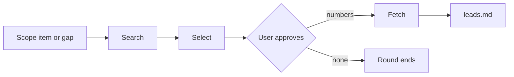
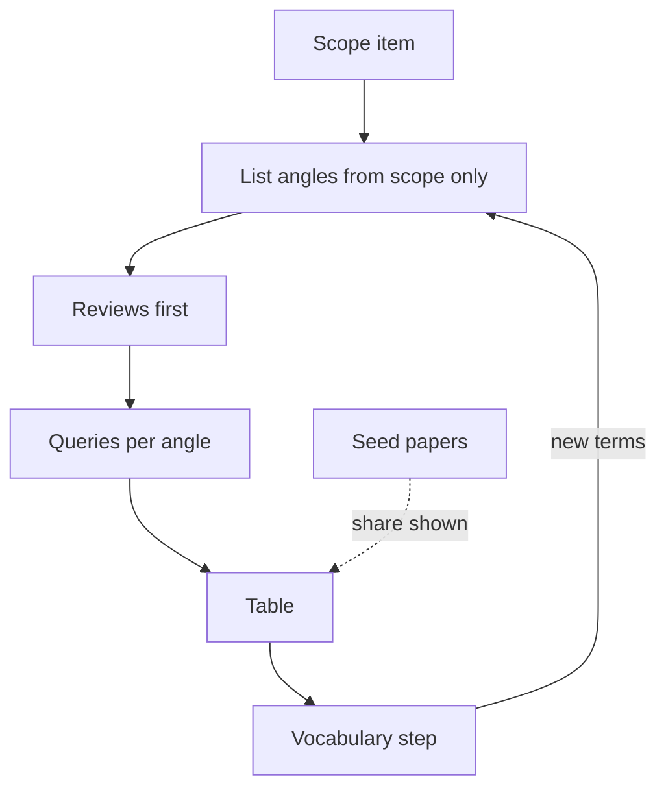

# Search-and-select engine: design (draft, nothing built yet)

How Claude finds papers on the scope, proposes which to read, and fetches the ones the user
approves. Status: under discussion on branch `dev-search-engine`. The acquisition states and
rules that already exist stay where they are (`leads.md`, `intake/own/source-access.md`,
`ai_instructions/mcp.md`); this file adds the part they lack: how candidates are searched and
chosen.

## The three stages

| Stage | Who | Result |
|---|---|---|
| Search | Claude writes the queries; a script runs them against OpenAlex and logs them | Candidates with metadata, already-held papers removed |
| Select | Claude ranks and gives one reason each; at most 15 per round | The approval table |
| Fetch | A script downloads the approved open copies and checks each first page against the title | `leads.md` rows move to `fetched`, `blocked` or `converted` |

Why the split: searching and fetching are mechanical and cost no model tokens as scripts; choosing
what is worth reading is judgment, and the user's approval is the control point.

## Rules

1. **No lead without a record.** A paper enters a table only if the search returned it. A title
   remembered by Claude is searched for first and used only if found. Why: this is what stops an
   invented paper from reaching the catalog.
2. **Queries are English.** A paper in another language is not excluded; its language is shown in
   the table's Venue cell, for example `(de)`. Why: English is the field's working language, but a
   good paper in another language should not be dropped by a filter.
3. **Held papers never appear.** Anything already in the catalog or in `leads.md` (any state) is
   removed before the table is built.
4. **The table** (the only thing the user is asked about):

   | # | Title | Year | Venue | Cited | Access | Covers | Found via |
   |---|---|---|---|---|---|---|---|

   `Access` is `open copy found`, `paywalled (you fetch)` or `unknown`. `Covers` names the scope
   item or gap that put the paper there; `Found via` names the search angle (see "Staying broad")
   or the seed paper it came from. The user answers with numbers: "download 1,2,3,6". Nothing is
   fetched before that.
5. **Selection order.** Fit to the named scope item or gap first. Then published articles before
   theses (a thesis is listed only where no article covers the point, marked `thesis`). Then
   citations per year since publication, so a recent paper is not buried by an old one. There is
   no year cutoff: an older paper is kept when it is heavily cited or when several shortlisted
   papers cite it. Why: some of the best papers are old, and the scope decides that, not a rule.
6. **Seeds.** A round can start from papers the user names: their references and the papers that
   cite them are candidates. Proposed only when the user asks ("look at what paper 3 cites"). A
   round is normally not all seeds: the table shows what share came from references or citations
   (see "Staying broad"). Why: following citations leads deeper into one corner of the field and
   never out of it, so the share is worth watching, though how high is fine depends on the field.
7. **Versions.** For every candidate the script lists all known locations (repositories, preprint
   servers, university pages), not only the publisher page, and picks an open one if any exists.
   For a paper with none, the table gives a Google Scholar search link on its exact title, so the
   user can open "All versions" by hand. Why: Scholar has no API and blocks automated use; the
   link costs nothing.
8. **Paywalled papers** go on a second list for the user, grouped by publisher, each with the DOI
   link and the filename to save under. The user saves the PDFs into one folder; a script matches
   each file to its lead by the DOI or title on its first page and marks it `user-fetched`.
   Claude never uses the user's login.
9. **First-page check.** After a download, the script compares the first page with the expected
   title. Only a mismatch is reported (a wrong paper, a "request access" page saved as a PDF).
10. **A round is a file**, `study/searches/round-NN.md`: the scope item, the queries run, the table
    shown and the user's answer. Why: approval survives across sessions, and the user can see
    afterwards what was proposed and declined.
11. **The engine never says "covered".** After a round it reports facts: how many new relevant
    papers, which angles were tried, which were not, and how many candidates were rejected as off
    topic. A thin round is reported as thin, with the untried angles named. Whether a topic is
    enough is the user's call. Why: a false "enough" ends the search early and the gap surfaces
    only in the article; a false "not yet" costs one more round.
12. **The queries are shown afterwards.** They are in the round file, in full, with the angle each
    belongs to. The user is not asked to approve them first.
13. **Failed downloads** are retried once on each other known location of the paper before the
    lead is marked `blocked`.
14. **Sources:** OpenAlex for search, references and citations; Crossref to resolve a DOI; arXiv
    for preprints. Semantic Scholar is left out (it rate-limits without a key).

## Staying broad

The risk: queries written from the papers already found keep returning that corner of the field,
and the survey ends up deep and narrow. Safeguards, each checkable from the round files:

1. **Angles are written before looking at results.** For each scope item Claude first lists the
   angles to search from `scope.md` alone: the problem in plain words, each method family the
   dossiers or the scope name, the neighbouring fields that solve a similar problem under another
   name, older terminology for the same thing, and "comparison of" / "limitations of" / "survey of"
   forms. The list is saved in the round file before the first query runs.
2. **Reviews first.** The first round of a scope item searches for survey and review papers. Their
   structure shows how the field divides itself; their reference lists seed later rounds. A review
   is one author's view, so it never replaces the other angles.
3. **A vocabulary step.** After each round the script lists the terms that appear in the titles,
   abstracts and OpenAlex topic labels of the round's papers and are absent from every earlier
   query, each marked with where it came from (abstract words are the paper's own; topic labels
   are a wider, noisier field vocabulary). Claude proposes some of
   them as new angles, never all, and says which are new. The user can add words too; their own
   vocabulary goes in as an angle.
4. **A drift reading, not a limit.** A script reports two shares for each round: how much of it came
   from references or citations, and how much from angles not used in the previous round. They go
   at the top of the table with a line from Claude on what they suggest. As a rule of thumb, a round
   made mostly of references or mostly of old angles is probably tunnelling, but there is no limit:
   a field with one dominant line of work may legitimately look like that, and Claude says so when
   it does.
5. **A similarity check.** The script compares each new query with every earlier one for the same
   scope item and flags near-duplicates, so a round of rewordings is visible as such.
6. **Room for the unfamiliar.** Ranking by citations favours the established. Claude keeps a few
   places in a round for recent papers with few citations and for papers from a neighbouring
   field, marked in the table. How many is its judgment from the literature found so far; a round
   with nothing worth that place leaves it empty.
7. **A coverage matrix.** `status.py` shows, per scope item, how many papers were fetched and from
   how many different angles. A scope item with papers from one angle only is shown as narrow,
   next to an item with none.

## Still open

- The two reported shares in "Staying broad" 4 and what a typical round looks like; tune on a real
  study, never as limits.
- The progress display: counts per stage in `/where`, and a line per stage in chat during a round.
